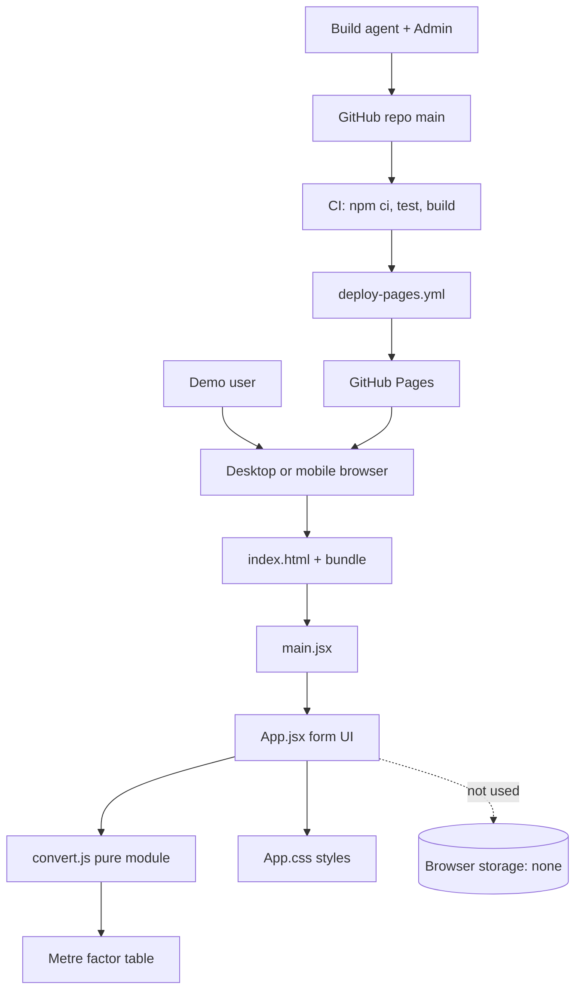

# Solution Design Document (Lite): Unit Converter

## Overview

Unit Converter is a proof of concept (POC) web app for an internal demo (Q1). One presenter and a handful of internal stakeholders (Q2) use it to convert a length between five units: foot (ft), inch (in), centimetre (cm), metre (m) and kilometre (km). That covers 20 distinct unit pairs.

The app runs entirely in the browser, with no server, storage or external calls (Q5, Q7). It is hosted on the GitHub Pages free tier with best-effort availability (Q3, Q8).

The chosen stack is plain React 18 with `useState`, on the starter template (React 18 + Vite 5, Vitest 2 + Testing Library + jsdom, GitHub Actions CI and Pages deployment):

- One `App` component holds the form state.
- A separate pure module, `src/convert.js`, owns the metre factor table, input parsing and result formatting (NFR-07).

It is built in one sprint of 18 planned points (Q10).

## Questionnaire summary

| Q | Answer in brief | Design consequence |
|---|---|---|
| Q1 Application Nature | POC for an internal demo; single-tenant; lifespan about 3 months | Minimal design. No extension points, config or multi-tenancy. Two source modules. |
| Q2 Users & Scale | 1 presenter plus a few stakeholders; latest desktop Chrome, Edge and Firefox; 375 px mobile | No scale design. Responsive CSS with a single column below 480 px. No polyfills for old browsers. |
| Q3 Availability | Best effort on the GitHub Pages free tier; no SLA, RTO or RPO | Static hosting only. Rollback means redeploying the previous commit. |
| Q4 Performance | Result in under 100 ms; page usable in under 2 s; convert on click or Enter only | Synchronous pure functions. No debounce or live conversion. Small bundle with no extra runtime libraries. |
| Q5 Security & Compliance | No auth, no PII, no browser storage, no data leaves the browser | No storage layer, cookies or network code. No secrets or environment variables. |
| Q6 AI | No AI used | A fixed factor table in code. No external API. |
| Q7 Integration | No runtime integrations, fonts or scripts | System font stack. No third-party runtime dependencies beyond React. |
| Q8 Infrastructure | GitHub Pages from `sdlc-demo-apps/sdlc-unit-converter-r5`; CI and `deploy-pages.yml` already in place | Keep the template workflows and npm scripts. Set the Vite `base` to the repo path. |
| Q9 Team & Operations | One AI build agent reviewed by the Admin; Admin owns operations; no monitoring | Simple, readable code. Tests are the main evidence. No monitoring hooks. |
| Q10 Budget & Timeline | Zero budget; open source only; one sprint (18 of 20 points) | Open-source tooling only. The Swap button (S9) is designed but built only if time permits. |

## Architecture diagram



The app never reads or writes browser storage (Q5). The dotted edge shows that this is a deliberate absence.

## Components

| Component (file) | Responsibility | Stories served |
|---|---|---|
| `index.html` | Page shell, `lang="en"`, viewport meta tag, root div | S7 |
| `src/main.jsx` | Mounts `<App />` in React StrictMode | All |
| `src/App.jsx` | Form: labelled input, From and To selects, Convert, Clear and optional Swap. Holds state with `useState`. Handles submit (click or Enter), the stale-result guard, the error display (`role="alert"`, `aria-describedby`) and the reset. | S1, S2, S4, S5, S6, S7, S9 |
| `src/convert.js` | Pure functions: `UNITS`, `parseLength`, `convertLength`, `formatResult`, `DEFAULTS`, `MESSAGES`. No React, DOM or storage. | S2, S3, S4, S8 |
| `src/App.css` | Layout, focus ring, contrast of at least 4.5:1, single column at 375 px | S7 |
| `src/convert.test.js` | Unit tests: 20-pair table, formatting, parsing | S2, S3, S4, S8 |
| `src/App.test.jsx` | Integration tests in jsdom: defaults, convert, Enter, errors, stale guard, Clear, labels, Swap | S1, S2, S4–S9 |
| `.github/workflows/ci.yml` | Runs `npm ci`, `npm test` and `npm run build` on pull requests and `main` | S8 |
| `.github/workflows/deploy-pages.yml` | Publishes `dist/` to GitHub Pages | S8 |

## Data flow

Main action: convert a length.

1. The user types `1` in the Length input. `onChange` sets `inputValue` and sets `result` to `null` (stale guard, S5).
2. The user selects From = ft and To = cm. Each `onChange` updates `fromUnit` or `toUnit` and sets `result` to `null`.
3. The user clicks Convert or presses Enter. Both submit the `<form>`, and `onSubmit` calls `preventDefault()`.
4. `App` calls `parseLength(inputValue)`.
   - If it returns `{ ok: false, error }`, `App` sets `error` to `MESSAGES[error]` and `result` to `null`, then goes to step 7.
5. `App` calls `convertLength(1, 'ft', 'cm')`. The function computes `1 × 0.3048 / 0.01` and returns `30.48` (as a float).
6. `App` calls `formatResult(30.48, 'cm')`, which returns `"30.48 cm"`. `App` sets `result` to that string and `error` to `null`.
7. React re-renders: the result appears in the output (`<output aria-live="polite">`), or the error appears in a `role="alert"` element linked to the input.

Storage step: none. Nothing is persisted (Q5, NFR-05). The whole flow is synchronous and in memory, well inside 100 ms (Q4).

## Interfaces and storage contract

**There is no server API.** The app makes no network calls (Q5, Q7). The only interfaces are the exports of `src/convert.js`:

| Export | Inputs | Output | Errors |
|---|---|---|---|
| `UNITS` | — | Frozen array of `{ id, label, symbol, toMetre }` objects in display order: ft, in, cm, m, km | — |
| `DEFAULTS` | — | `{ inputValue: '', fromUnit: 'm', toUnit: 'cm', result: null, error: null }` | — |
| `MESSAGES` | — | `{ invalid: 'Please enter a valid number', negative: 'Length cannot be negative' }` | — |
| `parseLength(raw: string)` | Raw input text | `{ ok: true, value: number }` or `{ ok: false, error: 'invalid' \| 'negative' }` | Never throws. The input is trimmed, then must match `/^-?\d+(\.\d+)?$/` or `/^-?\.\d+$/`. A non-matching or empty value returns `invalid`; a value below 0 returns `negative`. |
| `convertLength(value: number, from: UnitId, to: UnitId)` | A non-negative number and two unit IDs | `value × factor[from] / factor[to]` (number) | Throws `Error('Unknown unit: x')` for an unknown ID. This is unreachable from the UI. |
| `formatResult(value: number, unitId: UnitId)` | Number and unit ID | String such as `"0.000025 km"` | Throws for an unknown unit |

Formatting rule:

1. `value.toFixed(6)` rounds to 6 decimal places and returns plain decimal text, with no scientific notation for values below 1e21.
2. Trailing zeros are trimmed, then a trailing `.`.
3. `-0` becomes `0`.
4. The unit symbol is appended after a space.

**Browser-storage contract: none.** No localStorage, sessionStorage, IndexedDB or cookies, and no keys or JSON shapes (Q5, NFR-05). No version field is needed because nothing is persisted. If persistence were added later, it would require a change request and a key such as `unitConverter.v1` with `{ version: 1, ... }`.

## Data model

All data is in memory only.

**Unit** (constant in `convert.js`)

| Field | Type | Required | Description |
|---|---|---|---|
| id | `'ft' \| 'in' \| 'cm' \| 'm' \| 'km'` | Yes | Stable identifier and select option value |
| label | string | Yes | Dropdown text, for example `metre (m)` |
| symbol | string | Yes | Result suffix, for example `m` |
| toMetre | number | Yes | Exact factor: 0.3048, 0.0254, 0.01, 1 or 1000 (NFR-04) |

**FormState** (`useState` hooks in `App.jsx`)

| Field | Type | Required | Description |
|---|---|---|---|
| inputValue | string | Yes | Raw text in the input. Default `''`. |
| fromUnit | UnitId | Yes | Default `'m'` |
| toUnit | UnitId | Yes | Default `'cm'` |
| result | string \| null | No | Formatted result. `null` when empty or stale. |
| error | string \| null | No | Message text. `null` when there is no error. |

**ParseResult** (return value of `parseLength`)

| Field | Type | Required | Description |
|---|---|---|---|
| ok | boolean | Yes | `true` if the input is valid |
| value | number | When `ok` | Parsed non-negative number |
| error | `'invalid' \| 'negative'` | When not `ok` | Key into `MESSAGES` |

## Technology stack

| Layer | Choice | Version | Justification | Questionnaire ref |
|---|---|---|---|---|
| UI library | React with `useState` | 18.x | Template default. Five state fields need no extra library. | Q1, Q9 |
| Build tool | Vite | 5.x | Template default. Fast static build into `dist/`. Supports `base` for Pages. | Q8 |
| Domain logic | Plain JavaScript module (`convert.js`) | ES2020 | Pure and testable. Covers all 20 pairs without the UI. | Q4, Q9 |
| Styling | Plain CSS with custom properties, system font stack | — | No external fonts or network calls | Q7, Q5 |
| Unit and integration tests | Vitest + Testing Library (`@testing-library/react`, `user-event`) + jsdom | Vitest 2.x | Template default. Runs in CI. | Q8, Q9 |
| CI | GitHub Actions `ci.yml` | — | Already in place. Free. | Q8, Q10 |
| Hosting | GitHub Pages via `deploy-pages.yml` | — | Free, best-effort static hosting | Q3, Q10 |
| Runtime | Latest Chrome, Edge and Firefox | — | Matches the target audience. No polyfills. | Q2 |

## Repository structure

Repository: `sdlc-unit-converter-r5`. Files marked † are template files modified by this design. Files marked * are new.

```
sdlc-unit-converter-r5/
├── .github/
│   └── workflows/
│       ├── ci.yml                (template, unchanged)
│       └── deploy-pages.yml      (template, unchanged)
├── index.html                    † title "Unit Converter", lang="en"
├── package.json                  (template; scripts dev/test/build kept)
├── vite.config.js                † base '/sdlc-unit-converter-r5/'
└── src/
    ├── main.jsx                  † imports App.css
    ├── App.jsx                   † converter form
    ├── App.css                   * styles, focus ring, responsive
    ├── App.test.jsx              † integration tests
    ├── convert.js                * pure conversion module
    └── convert.test.js           * unit tests (20 pairs)
```

## Environment variables and build configuration

**No environment variables are needed.** The app has no server, API keys, secrets or environment-specific endpoints (Q5, Q7). No `.env` files are created.

Build configuration in `vite.config.js`:

- `base: '/sdlc-unit-converter-r5/'`, so asset URLs resolve at https://sdlc-demo-apps.github.io/sdlc-unit-converter-r5/ (Q8).
- `test: { environment: 'jsdom', globals: true }`, kept from the template.

The npm scripts `npm ci`, `npm test` and `npm run build` are unchanged. `deploy-pages.yml` publishes `dist/` on merge to `main` after Gate 7 (Q8).

## Testing approach

| Test file | Type | What is tested | Stories |
|---|---|---|---|
| `convert.test.js` | Unit | `it.each` over all 20 distinct pairs for input `1`. Expected strings come from the exact factors, for example ft→cm `30.48 cm`, in→km `0.000025 km`, km→m `1000 m`, cm→in `0.393701 in`. | S2, S8 |
| `convert.test.js` | Unit | `formatResult`: trims trailing zeros (`0.0254 m`), shows integers without a point (`250 cm`), never contains `e`, returns `0` for tiny values | S3 |
| `convert.test.js` | Unit | `parseLength`: `''`, `'abc'` and `'1,5'` return `invalid`; `'-5'` returns `negative`; `' 2.5 '` returns 2.5; `'0'` is valid | S4 |
| `App.test.jsx` | Integration | Defaults on load; each select has exactly 5 options; controls found with `getByLabelText` | S1, S7 |
| `App.test.jsx` | Integration | Convert click (`30.48 cm`); Enter key (`1000 m`); no result while typing or changing units | S2 |
| `App.test.jsx` | Integration | Error messages appear in `role="alert"` with no result; the error clears after a valid convert | S4 |
| `App.test.jsx` | Integration | Stale guard: editing the input, From or To empties the output | S5 |
| `App.test.jsx` | Integration | Clear restores the defaults and removes the error | S6 |
| `App.test.jsx` | Integration | Tab order input → From → To → Convert → Clear (`user.tab()`) | S7 |
| `App.test.jsx` | Integration | Swap exchanges the units and clears the result; queried by the name `Swap units` (added only if S9 is built) | S9 |

Test names start with the story ID, for example `S2: converts 1 ft to 30.48 cm`, so the Test Report can map them.

Two S7 checks are done by hand in Chrome DevTools, because jsdom has no layout:

- the 375 px layout;
- the visible focus ring.

## ADRs

### ADR-1: Tech stack

- **Context:** A 5-unit converter POC on the React 18 + Vite 5 template. It must keep the npm scripts and Pages deployment (Q1, Q8, Q10).
- **Options considered:**
  1. Plain React 18 with `useState` and a pure conversion module.
  2. React 18 with `useReducer` and a reducer module for all form transitions.
  3. React 18 with a form library (React Hook Form) for input and validation.
- **Decision:** Option 1, chosen by the Admin.
- **Rationale:**
  - Five state fields and three events do not justify a reducer or a library (Q1).
  - The pure module isolates the logic that needs the most testing (Q9).
  - No extra dependencies are needed (Q7, Q10).
- **Consequences:**
  - State transitions such as reset and the stale guard live in `App.jsx` handlers, so they are tested through integration tests.
  - If the app grew, moving to `useReducer` would be simple.
- **Status:** Accepted

### ADR-2: No persistence or browser storage

- **Context:** The BRD excludes history and persistence. NFR-05 forbids storage (Q5).
- **Options considered:**
  1. In-memory state only.
  2. localStorage with a versioned key for the last units.
  3. URL query parameters for shareable state.
- **Decision:** Option 1.
- **Rationale:**
  - It matches the approved scope and Q5 (no data stored or sent).
  - Clear and first-load behaviour stay deterministic.
- **Consequences:**
  - A page refresh resets to the defaults.
  - There is no storage contract or migration to maintain.
- **Status:** Accepted

### ADR-3: Metre base table and fixed-decimal formatting

- **Context:** 20 pairs must match reference values. Results must show at most 6 decimals and no scientific notation (Q4, NFR-04).
- **Options considered:**
  1. A metre factor table plus `toFixed(6)` and zero trimming.
  2. A 5×5 direct factor matrix plus `toPrecision`.
  3. A decimal library (for example decimal.js) for exact arithmetic.
- **Decision:** Option 1.
- **Rationale:**
  - Five factors are easier to verify than 20.
  - `toFixed` never emits exponents below 1e21 and absorbs float noise, for example 30.479999…; `toPrecision` can emit exponents.
  - A library adds weight for no visible gain (Q7, Q10).
- **Consequences:**
  - Values below 0.0000005 display as `0`, as the BRD assumes.
  - Extremely large inputs are outside the tested range.
- **Status:** Accepted

## Sign-off

| Role | Name | Decision | Date |
|---|---|---|---|
| Approver (Sponsor and Product Owner) | Admin | Pending gate approval | Pending |

Status: **Pending gate approval** (Gate 3: SDD sign-off).
